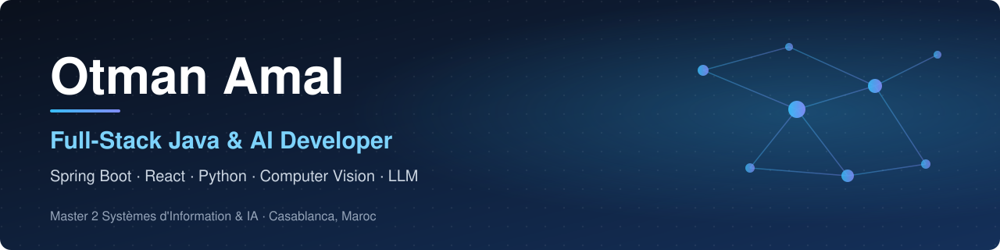

  

  <a href="#projets">Projets</a> · <a href="#compétences">Compétences</a> · <a href="#formation">Formation</a> · <a href="#contact">Contact</a>

Étudiant en Master 2 Systèmes d’Information et Intelligence Artificielle, je développe des applications web, prépare et analyse des données, et travaille sur des modèles de vision par ordinateur ainsi que sur l’intégration d’API de LLM. Mon intérêt est de relier ces compétences : exploiter des données fiables, évaluer les modèles et les intégrer dans des applications utiles et utilisables.

Je cherche un PFE ou un premier poste : Software Engineer, développeur Java / Full-Stack, IA / Data (junior).

📍 Casablanca, Maroc · 📧 [otman.amal01@gmail.com](mailto:otman.amal01@gmail.com) · 💼 [lien LinkedIn]

## Projets

#### [ExpenseFlow](https://github.com/otman-aml/expenseflow)
*Gestion des notes de frais en entreprise, avec extraction par LLM*

Un employé soumet ses dépenses, son manager puis la finance les valident. Chaque catégorie a un plafond et chaque action est enregistrée. L'employé peut aussi écrire sa dépense en une phrase : un LLM remplit le formulaire, et si l'appel échoue, la saisie manuelle reste disponible. Le LLM propose seulement, l'approbation et les montants restent calculés côté Java.

Projet personnel, avec des données fictives.

      

#### [Détection de blocage d'un crible vibrant](https://github.com/otman-aml/screen-blockage-detection)
*Prototype de vision par ordinateur, projet OCP*

Prototype qui détecte le blocage d'un crible vibrant par segmentation d'instances (YOLOv8). Le modèle est exposé par une API FastAPI et consommé par un backend Spring Boot.

Ce qui est réalisé : le modèle et la chaîne logicielle (API et backend). Ce qui reste hypothétique : le branchement sur un site industriel réel (caméra, conditions de terrain, déploiement), qui n'est pas couvert par ce prototype.

    

#### [Analyse de véhicules sur vidéo](https://github.com/otman-aml/autonomous-vehicle-analytics)
*Expérimentation en notebook*

Détection des véhicules avec YOLOv8, suivi avec ByteTrack et estimation de leur vitesse, le tout dans un notebook Jupyter.

   

#### [Gestion des stagiaires](https://github.com/otman-aml/gestion-stagiaires)
*Application web*

Application web de gestion des stagiaires en entreprise.

  

## Compétences

| Domaine | Technologies |
|---|---|
| **Développement** |           |
| **Bases de données** |    |
| **Data** |     Nettoyage et préparation des données, analyse exploratoire |
| **Intelligence artificielle** |        Classification, régression, clustering, détection et segmentation d'objets, suivi multi-objets |
| **Outils** |        |
| **Notions vues en formation** |       |

## Formation

- **2025 - Présent** : Master d'Excellence en Systèmes d'Information et Intelligence Artificielle, Université Sultan Moulay Slimane
- **2024 - 2025** : Licence d'Excellence en Systèmes d'Information et Intelligence Artificielle, Faculté Polydisciplinaire de Khouribga
- **2021 - 2023** : Brevet de Technicien Supérieur (BTS) en Développement des Systèmes d'Information, Lycée technique de Settat (Mention Bien)
- **2020 - 2021** : Baccalauréat en Sciences de la Vie et de la Terre, Lycée Laghnimiyine, Berrechid (Mention Très Bien)

**Langues** : arabe (langue maternelle), français (professionnel), anglais (technique, intermédiaire)

## Contact

Pour un PFE, un stage ou un premier poste, le plus simple est de m'écrire : [otman.amal01@gmail.com](mailto:otman.amal01@gmail.com) ou [LinkedIn](lien LinkedIn).
